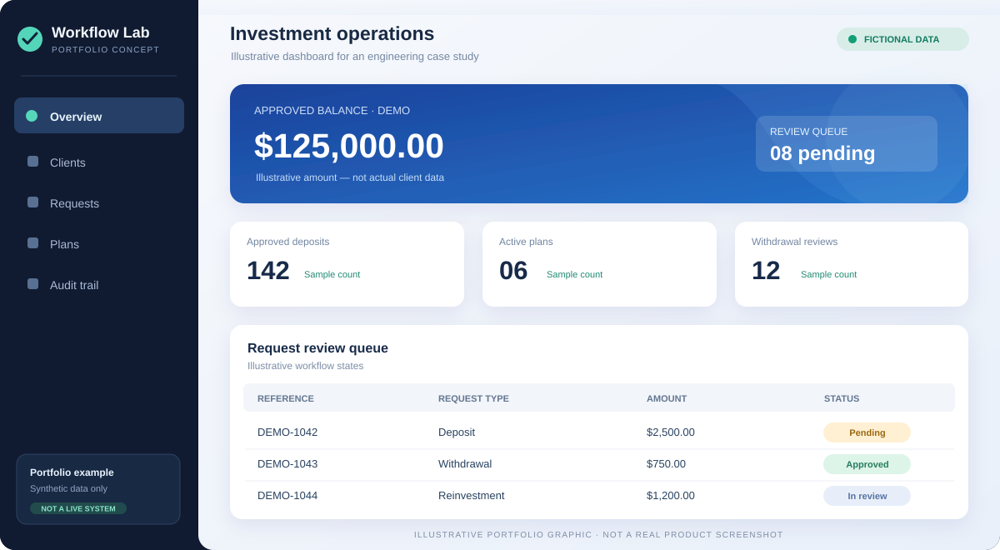
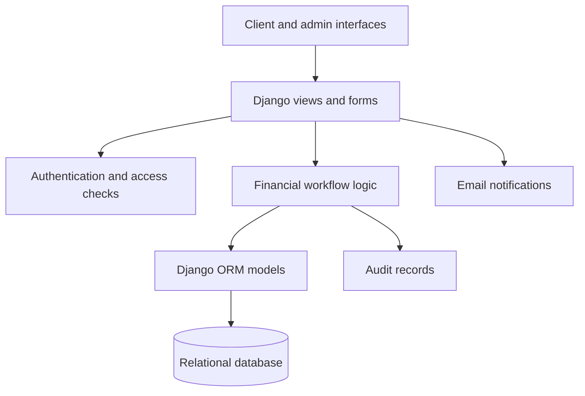

# Investment Administration Platform — Django Engineering Case Study

**Python · Django · relational data modelling · financial workflows · role-based application design · automated tests**

This is a public, anonymized portfolio showcase of an investment-administration web application I developed for a client. The original application and source repository remain private. The small Python demonstration here was written independently to illustrate engineering practices; **it is not the client's source code or a functioning investment service**.



> The dashboard is an original, illustrative mockup using fictional data. It does not depict the deployed client application.

## What the client project covered

- **Accounts and access:** client and administrator interfaces, controlled account approvals, invitation-based setup, and password reset.
- **Operations:** investment-plan administration and deposit, withdrawal, reinvestment, and referral workflows with review states.
- **Financial calculations:** decimal-based balances, maturity/cycle-based returns, available-balance checks, and allocation logic.
- **Administration:** client and transaction review screens, audit records, support enquiries, and configurable site settings.
- **Notifications:** templated emails for selected account and transaction events.
- **Testing:** Django tests for calculations, insufficient balances, selected access paths, approval workflows, and email-error handling.

These are features identified in the project's source during review. They do **not** imply that payment processing, financial compliance, security, or production reliability has been independently audited.

## Technical stack of the client project

| Layer | Technology / approach |
| --- | --- |
| Backend | Python, Django 6 |
| Web UI | Django templates, HTML, CSS, JavaScript |
| Data | Django ORM, relational models, SQLite in the inspected configuration |
| Static assets | WhiteNoise |
| Notifications | SMTP email templates |
| Validation | Django tests covering selected financial and application flows |

## Architecture at a glance



For details, see [Architecture notes](docs/ARCHITECTURE.md) and [Project case study](docs/CASE_STUDY.md).

## A specific engineering challenge

Financial actions should not partially consume a user's available balance when the requested amount cannot be fully covered. The inspected application's allocation routine first builds a proposed allocation and checks for a complete match before applying deductions. Its tests include insufficient-balance and failed-allocation cases.

This is **not equivalent to a concurrency-safe, database-transactional accounting system**. Transaction boundaries, locking, reconciliation, and security review would be required before making production-grade financial guarantees.

## Public, independently written demo

The `demo/` folder contains a small standard-library Python example of a review-driven deposit/withdrawal ledger, using synthetic transactions to illustrate:

1. Exact monetary values with `Decimal`.
2. Pending, approved, and rejected state transitions.
3. Reservation of funds for pending withdrawal requests.
4. Validation before mutation and explicit audit events.
5. Automated unit tests for normal and failed paths.

Run with Python 3.11+ (no third-party dependencies):

```bash
python -m unittest discover -s demo -p "test_*.py" -v
python -m demo.example
```

The demo is **educational only**, runs in memory, and does not connect to a bank, payment provider, live database, or the original client system.

## What is deliberately excluded

- Original client source code and database.
- Customer accounts, personal information, transaction details, credentials, and API keys.
- Company branding, client-owned imagery, internal documents, and private URLs.
- Claims of independent deployment verification, penetration testing, legal/compliance validation, or performance certification.

## My contribution and project status

I developed the Django application and report having deployed the client project. The engineering details in this showcase are grounded in an inspection of a private source copy. The deployment claim has not been independently verified for this public repository; the example program here is a separate, runnable portfolio artifact.

**Portfolio focus:** Python/Django backend development, data modelling, application architecture, transaction-state handling, test design, and clear technical documentation.

This repository is a showcase, not an investment offering or a service for handling real funds.
