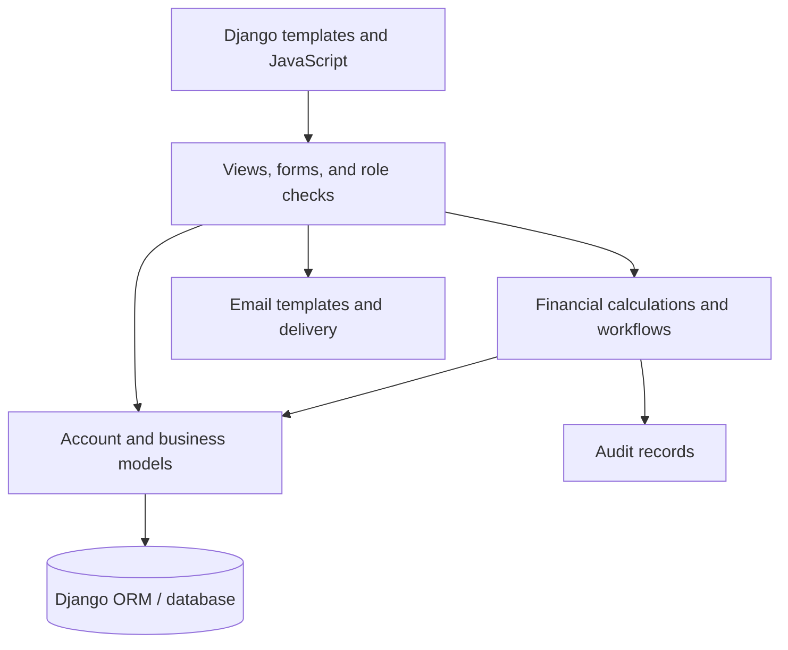

# Architecture notes

These notes summarize major concepts visible in the inspected Django source. They do not disclose proprietary endpoint details or client configuration.

## Responsibilities

- **Presentation:** server-rendered templates and client-side JavaScript for public, client, and administrative screens.
- **Application:** Django routing, request validation, authentication, permissions, and review workflows.
- **Domain:** balance, return-cycle, and allocation calculations.
- **Persistence:** custom user accounts, plans, deposits, withdrawals, investments, reinvestments, referrals, and audit logs.
- **Infrastructure:** email templates, SMTP configuration, static files, and settings.

## Conceptual entities

| Entity | Purpose |
| --- | --- |
| User | Identity, role, approval and invitation status |
| InvestmentPlan | Minimum amount and return-cycle configuration |
| Deposit | User funding request linked to a plan and review status |
| Investment | Investment snapshot and lifecycle information |
| Withdrawal | Requested amount and review status |
| Reinvestment | Transfer of eligible balance into a new investment |
| ReferralBonus | Earned and consumed referral bonus amounts |
| AuditLog | Trace of selected user and administrative activity |

## Correctness boundary

Sequentially planning and applying deductions avoids partial allocation when requested funds are insufficient. It does not prove safety against simultaneous requests or database failures halfway through updates. That requires transaction boundaries, locking, and concurrency tests.

The independent public demo models money and state transitions **in memory only**. It does not reproduce the client's business terms, actual ROI logic, security controls, or integrations.
