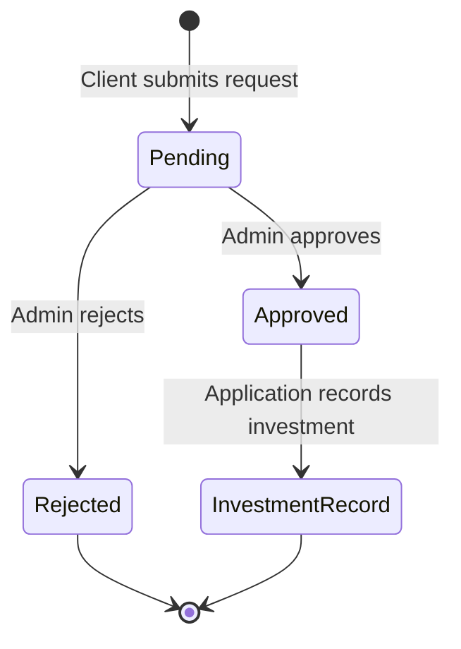

# Case study: Client investment administration application

## Context

The project involved building an authenticated web application around investment-account administration. Clients view their accounts and submit requests; administrators review accounts, plans, and transactions. The goal was to turn fragmented manual interactions into traceable application workflows.

This case study is anonymized. It omits the client's name, contact details, proprietary content, business terms, and confidential data.

## Responsibilities demonstrated in the inspected source

| Area | Implementation evidence |
| --- | --- |
| Application structure | Django applications separated into `accounts` and `core`, with routes, views, templates, models, migrations |
| Accounts | Custom user model, client/admin roles, approval gate, invitations, login, password-reset routes |
| Transaction lifecycle | Models and routes for deposits, withdrawals, investments, and reinvestment requests |
| Financial services | Separate `Decimal` calculation module and tests of ROI cycles, maturity, balances, allocation failures |
| Administrative tools | Account, assessment, consultation, plan, deposit, withdrawal, and support review screens |
| Traceability | Audit-log model and transaction-related notification templates |
| Testing | Django tests for financial results and selected critical application flows |

## Representative process: deposit review

This diagram shows only the reviewed high-level states. It is not a full business-process specification.

## Engineering decisions worth discussing

### Separate calculations from page rendering

Financial calculation functions are in a dedicated service module rather than only in templates. That makes it possible to test their behavior separately and reuse results in multiple workflows.

### Use exact decimal arithmetic

Investment and transaction amounts use Django `DecimalField`, while calculation code uses Python `Decimal` rather than binary floating point.

### Validate balances before updating records

The inspected allocation routine plans deductions, checks whether the requested amount is coverable, and then updates records. Tests cover insufficient funds leaving prior balances unchanged. This is an application-level safeguard, not proof of isolation under concurrent requests.

### Model review statuses explicitly

Deposits and withdrawals have tracked statuses. Submitted requests can be reviewed instead of being treated as automatically settled.

### Isolate selected notification failures

Tests cover notification failure without necessarily cancelling the underlying valid business operation. A more mature deployment could use durable queues and retry policies.

## Validation and limitations

During preparation of this public case study:

- The private staging archive was inspected for file structure and obvious credential patterns.
- All 50 Python files passed static syntax parsing.
- Django tests and their intended cases were reviewed, but **the original Django test suite was not executed** during that inspection.
- No independent penetration test, performance benchmark, payment verification, or financial compliance assessment was conducted.
- The developer reports an earlier client deployment, **not independently confirmed** through production records.

The separate educational demo is unit-tested within this public repository. It does not validate the private Django application.

## Future engineering priorities

Production-hardening would prioritize database transactions and locking for balance mutations; privileged-route authorization testing; idempotency; audit reconciliation; queued notifications; and operational monitoring.

These are **recommendations**, not claims of completed work.

## Public disclosure boundaries

The public package contains no original application code, client contacts, customer data, client branding, or production credentials. All diagrams and graphics are newly authored abstractions with fictional data. Any real screenshot or source excerpt needs an independent privacy and publication-rights review.
